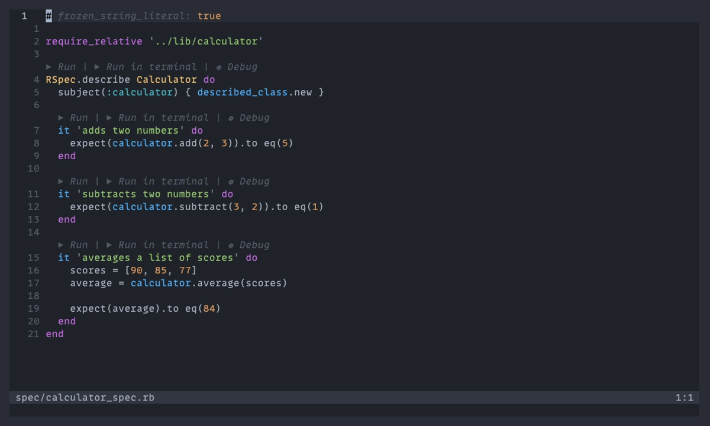

# ruby-lsp.nvim

Make [Ruby LSP](https://github.com/Shopify/ruby-lsp) code lenses work in Neovim. **Run**, **Run In Terminal**, and **Debug** appear above your tests, and with this plugin they actually do something: run through [neotest](https://github.com/nvim-neotest/neotest), open a terminal, or start a debugger with [nvim-dap](https://github.com/mfussenegger/nvim-dap).



## 💡 Why

Ruby LSP's code lenses call client-side commands like `rubyLsp.runTest` and `rubyLsp.debugTest`. VS Code's Ruby LSP extension implements them, but Neovim doesn't, so choosing a code lens fails with "Language server does not support command".

This plugin implements all five commands through `vim.lsp.commands`, and adds a neotest adapter and an rdbg debug adapter that use Ruby LSP to find and run your tests.

## 📝 Commands

| Command | What it does |
|---|---|
| `rubyLsp.runTest` | Runs the test through neotest if it's installed, otherwise in a terminal |
| `rubyLsp.runTestInTerminal` | Runs the test in a terminal |
| `rubyLsp.debugTest` | Debugs the test with nvim-dap and rdbg |
| `rubyLsp.openFile` | Opens a file, jumping to the line when one is given |
| `rubyLsp.runTask` | Runs a task such as a migration in a terminal |

### User commands

Set `user_commands = true` to add these commands to buffers Ruby LSP is attached to:

| Command | What it does |
|---|---|
| `:RubyLspShowDependencies [all]` | Lists the project's direct dependencies in the quickfix list, or every gem with `all` |
| `:RubyLspShowSyntaxTree` | Shows the syntax tree for the buffer in a vertical split. Press `q` to close it. |
| `:RubyLspDiscoverTests` | Lists the tests Ruby LSP finds in the buffer in the quickfix list |

## 📋 Requirements

- Neovim >= 0.12
- [Ruby LSP](https://github.com/Shopify/ruby-lsp) >= 0.23.0, installed with `gem install ruby-lsp`. With a Ruby version manager, install it once for each Ruby version you use.

### Optional

- [neotest](https://github.com/nvim-neotest/neotest) to run tests through neotest
- [nvim-dap](https://github.com/mfussenegger/nvim-dap) and the [debug](https://github.com/ruby/debug) gem, to debug tests and scripts
- [toggleterm.nvim](https://github.com/akinsho/toggleterm.nvim) to run tests in toggleterm instead of a split
- [ruby-lsp-rspec](https://github.com/st0012/ruby-lsp-rspec) in your Gemfile for RSpec projects. Minitest works out of the box.

## 🛠️ Installation

With [lazy.nvim](https://github.com/folke/lazy.nvim):

```lua
{
  "wassimk/ruby-lsp.nvim",
  version = "*",
  lazy = false,
  opts = {},
}
```

Don't lazy-load the plugin. Its `lsp/ruby_lsp.lua` must be on the runtimepath before Ruby LSP starts, and loading it is cheap. When nvim-dap is installed, `setup()` also loads nvim-dap at startup to register the debug adapter.

If you're upgrading and already start Ruby LSP yourself, remove your `vim.lsp.enable("ruby_lsp")` call and your `fullTestDiscovery` setting. Or set `lsp.auto_start = false` and keep your `vim.lsp.enable("ruby_lsp")` call, as long as the plugin still isn't lazy-loaded.

## 🖥️ Ruby LSP Server

The plugin configures and starts Ruby LSP for you, in any project with a `Gemfile` or `.git` directory. You don't need nvim-lspconfig or a `ruby_lsp` config of your own. If nvim-lspconfig is installed, its config merges with the plugin's without conflict.

Before starting, the plugin checks that `ruby-lsp --version` runs from the project root. If you set `cmd` to a list such as `{ "bundle", "exec", "ruby-lsp" }`, it only checks that the first entry is executable. When the check fails, the server stays off and nothing is shown. Run `:checkhealth ruby-lsp` to see why.

Set `lsp.auto_start` to choose where the server starts. `true` starts it in every Ruby project, and `false` leaves it to you to call `vim.lsp.enable("ruby_lsp")`. A function decides per project. This one skips projects that use solargraph:

```lua
require("ruby-lsp").setup({
  lsp = {
    auto_start = function(root_dir)
      return vim.fn.filereadable(root_dir .. "/.solargraph.yml") == 0
    end,
  },
})
```

To customize the server, use `after/lsp/ruby_lsp.lua` or `vim.lsp.config("ruby_lsp", { ... })`. Your settings merge on top of the plugin's:

```lua
vim.lsp.config("ruby_lsp", {
  init_options = {
    formatter = "standard",
  },
})
```

If you override `root_dir`, your function replaces the plugin's start checks, including `lsp.auto_start` and the check that `ruby-lsp` runs.

## 🧪 Neotest

The neotest adapter finds tests with Ruby LSP and runs the commands Ruby LSP resolves for them, so it works the same for Minitest and RSpec, in Rails apps or plain Ruby projects. Register it in your neotest setup:

```lua
require("neotest").setup({
  adapters = {
    require("ruby-lsp.neotest"),
  },
})
```

With neotest installed, the **Run** code lens goes through neotest too, so results show up in neotest's signs, summary, and output. **Run In Terminal** always uses a terminal.

## 🐞 Debugging

When nvim-dap is installed, the plugin registers a `ruby` debug adapter that starts your tests under rdbg. The **Debug** code lens uses it, and the plugin adds three configurations:

- **Ruby LSP: debug nearest test** debugs the test under the cursor
- **Ruby LSP: debug current file** runs the current file with `ruby`
- **Ruby LSP: debug current file (arguments)** asks for arguments first

They appear in `dap.continue()` alongside your own `dap.configurations.ruby`. Set `dap.configurations = false` to hide them.

In a project with a `Gemfile`, the adapter runs rdbg with `bundle exec` from the project root, so the `debug` gem must be in your bundle. For a loose script outside a project, it runs rdbg directly, so install the gem globally with `gem install debug`.

Sessions stop at your first breakpoint. Set `dap.auto_configure = false` to use your own adapter instead. The plugin also skips its configurations when another adapter is already registered under the `dap.adapter` name, since they depend on its own adapter.

## ⚙️ Options

These are the defaults. You only need to pass the ones you want to change.

```lua
require("ruby-lsp").setup({
  -- How to run tests in a terminal.
  -- "split" (builtin) | "toggleterm" | function(cmd, opts)
  executor = "split",

  -- Split executor options
  split = {
    direction = "horizontal", -- "horizontal" | "vertical"
    size = 15,
  },

  -- Toggleterm executor options
  toggleterm = {
    direction = "float", -- "float" | "horizontal" | "vertical"
    close_on_exit = false,
  },

  -- Task runner options (e.g., migrations)
  task = {
    keep_open = true, -- keep the terminal open after the task finishes
  },

  -- Debugging
  dap = {
    auto_configure = true, -- register the rdbg adapter when nvim-dap is available
    adapter = "ruby",      -- debug adapter type name
    configurations = true, -- add the Ruby LSP debug configurations to nvim-dap
  },

  -- Neotest test discovery
  test_discovery = {
    -- show progress while discovering the project's tests,
    -- or while waiting for Ruby LSP to start or finish indexing
    progress = true,
  },

  -- Ruby LSP server
  lsp = {
    -- start the server in Ruby projects.
    -- true | false | function(root_dir): boolean
    auto_start = true,
  },

  -- Add :RubyLsp* user commands to buffers Ruby LSP is attached to
  user_commands = false,
})
```

## 🩺 Health Check

```
:checkhealth ruby-lsp
```

It reports whether `ruby-lsp` runs from the current project, the `lsp.auto_start` setting, whether the server is running, and the optional tools the plugin can use.

## 🔧 Development

One-time setup to enable the local git hooks:

```shell
make setup
```

The pre-commit hook checks Lua formatting with [stylua](https://github.com/JohnnyMorganz/StyLua) and regenerates `doc/ruby-lsp.nvim.txt` from `README.md` whenever the README is staged. It requires [pandoc](https://pandoc.org/installing.html).

```shell
make lint  # check Lua formatting
make docs  # regenerate vimdoc from README.md
```

## 🙏 Acknowledgements

Thank you to the [Ruby LSP](https://github.com/Shopify/ruby-lsp) team for such a great tool. This isn't an official Ruby LSP project, just my work to make Ruby LSP feel at home in Neovim.
